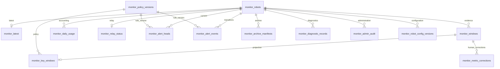

# 中央大屏 PostgreSQL 数据库设计

状态（2026-10-23）：本机独立Docker PostgreSQL 18.6已执行001、002、004，并在备份后显式部署005，共14表，接入独立管理员页面、机型/温度策略管理与模拟大屏；当前完整SQLite＋隔离PostgreSQL回归417项通过。入口、登录文件、实测记录见 [管理与数据库部署](MANAGEMENT_AND_POSTGRES.md)。旧库导入003未执行，原平台55432库未改动；不执行10台8～24小时耐久测试，不宣称实机验收。

## 审核入口

| 文件 | 用途 |
|---|---|
| [001_schema.review.sql](../deploy/postgres/001_schema.review.sql) | 与当前应用元数据一致的11张表、约束和索引；面向全新专用数据库 |
| [002_permissions.review.sql](../deploy/postgres/002_permissions.review.sql) | 应用、只读查询、归档、监控管理员四个业务组角色及安全视图；无密码 |
| [003_legacy_import.review.sql](../deploy/postgres/003_legacy_import.review.sql) | 可选迁移模板；从同库中已审阅恢复的 legacy_monitor 暂存区导入，保留原ID、原时间、哈希 |
| [004_admin.review.sql](../deploy/postgres/004_admin.review.sql) | 监控管理员的受控操作、两张管理扩展表及当前更正视图；已接入独立管理API/页面 |
| [005_robot_configuration.review.sql](../deploy/postgres/005_robot_configuration.review.sql) | 逐机器人机型与温度配置版本、CAS、配置审计及原子创建受控函数；已显式部署到独立模拟中央环境 |
| [compose.review.yml](../deploy/postgres/compose.review.yml) | 审核后的Docker部署草案；当前未执行，不自动挂载初始化SQL |
| [central-policy.example.json](../deploy/central-policy.example.json) | 关键指标白名单、30天到期预览、告警持续时间与积压参数 |

目标使用 PostgreSQL 18 稳定系列；部署时再确认可用小版本并记录镜像digest。应用通过现有 SQLAlchemy/psycopg 接入，无需 TimescaleDB、Redis、外部消息队列或数据库扩展。全部监控数据在独立数据库和 `rp1_monitor` schema，不关联正式测试、审批或MTBF表。

## 数据链路与职责

机器人只读采集与源端缓存 → 网线上位机relay可靠落盘 → 中央API → 原始证据/关键曲线/容量日账 → 网页和只读诊断Agent。

机器人无中央地址或凭据。新增 relay-status 为上位机独立状态通道，只用绑定设备的现有上传凭据；不修改机器人原始窗口或其哈希。数据库连接凭据只由中央服务持有，网页只读访问API。

## 表设计

| 表 | 主键/唯一约束 | 主要内容和生命周期 |
|---|---|---|
| monitor_robots | robot_id；token_digest唯一 | 设备名、simulated/ros2来源、启用状态、关节名单；只存高熵设备令牌的SHA256 |
| monitor_windows | bigint自增id；robot_id+stream_id+sequence唯一 | 原始起止时间、中央接收时间、原始规范哈希及JSON证据；补传只写历史，不刷新当前状态 |
| monitor_latest | robot_id | 当前被接受的live窗口；保留采集实例及首次观察时间，拒绝旧实例回滚当前状态 |
| monitor_policy_versions | policy_sha256 | 不可变策略JSON及创建时间；策略变化产生新版本 |
| monitor_key_windows | window_id外键兼主键 | 白名单匹配指标、每项单位/聚合方式、样本数/年龄/极值/最后值、策略SHA和逻辑字节数 |
| monitor_daily_usage | robot_id+received_day | UTC接收日的去重窗口数、原始JSON字节、关键JSON字节；不累计重复补传 |
| monitor_relay_status | robot_id | 最新上位机会话、递增序号、观测/接收时间、缓存与磁盘状态；旧序号不刷新新鲜度 |
| monitor_alert_heads | robot_id+rule_key | normal/pending/active/unknown、是否仍未恢复、持续起点、打开时间、评估时间、策略及事实 |
| monitor_alert_events | bigint自增id | opened/recovered/observation_lost/observation_restored；只追加状态变化，保留来源与原始观测时间 |
| monitor_archive_manifests | archive_id；file_name唯一 | UTC小时段、高水位原始ID、数量、压缩字节、文件SHA256；只为完整校验通过的文件登记 |
| monitor_diagnostic_records | report_id | 独立只读诊断报告、创建时间及规范哈希；不进入正式测试统计 |
| monitor_metric_corrections | bigint自增id；window_id+metric_key+previous_id唯一且NULLS NOT DISTINCT | 追加人工更正/排除/恢复版本，绑定原始窗口及哈希，不覆盖原始遥测 |
| monitor_admin_audit | bigint自增id | 设备登记、历史更正及配置保存的前后值、原因、数据库个人登录和数据库时间；只追加 |
| monitor_robot_config_versions | bigint自增id；robot_id+previous_id唯一且NULLS NOT DISTINCT | 24／28自由度完整关节清单、机型版本、映射确认状态、总线/电机编号、显示色阶及本机器人电机/MOS温度限值；每次保存追加版本 |

所有时间使用 `timestamptz`，应用输出明确时区，数据库默认UTC。业务设备编号和协议已有UUID字符串继续使用text，避免改写现有采集身份；高频追加表使用bigint自增ID。日账日期使用UTC午夜的timestamptz，由中央代码统一生成。

原始证据、诊断报告和策略快照使用 **JSON**，保留数字往返表示以重算规范哈希；例如 `-0.0` 不能在保存原证据时被规范化为 `0.0`。关键曲线、最新状态、relay状态和告警事实使用 **JSONB**，用于结构化查询。JSONB的表示方式与JSON不同，这是有意区分的完整性契约，参见 [PostgreSQL JSON类型文档](https://www.postgresql.org/docs/18/datatype-json.html)。

## 事务、确认与来源边界

写入顺序固定为：策略版本 → 绑定机器人行锁 → 原始窗口 → 关键投影和日账 → 可接受的最新窗口 → 提交 → 返回确认。投影或计量失败会回滚整批，不会只确认半份证据。告警评估和显式旧数据回填使用相同的策略/机器人锁顺序，避免跨进程相反取锁。

`robot_id+stream_id+sequence` 全局唯一；相同身份相同内容返回重复确认，内容不一致拒绝。JSON旧可选字段的兼容比较继续保留。设备来源与ID由服务端登记和凭据绑定；模拟与ROS2不能混入同一设备身份。原始窗口、策略版本和事件不通过应用更新或删除。

缺失值不填0；无新样本窗口保留 `count=0`。关键层未选中的指标显示缺口，仍可切换原始摘要层查询。白名单调整只作用于新投影，不追改既有策略。旧数据通过显式回填追加缺少的投影，保留原始数据、接收时间和哈希。

## 索引与大表取舍

- 原始历史 `(robot_id,window_end)` B-tree用于单设备时间范围、曲线和归档查询，先设备等值再时间范围；对应 [多列索引文档](https://www.postgresql.org/docs/18/indexes-multicolumn.html)。
- `window_end` BRIN用于跨设备到期扫描；补传会影响物理相关性，部署后再通过EXPLAIN验证收益。
- 关键层 `(robot_id,window_end)` B-tree，按window_id主键关联原始证据。
- 告警头有 `WHERE is_open=true` 的部分索引；事件 `(robot_id,id)` 使用游标分页，不使用大OFFSET。
- 配置版本 `(robot_id,id DESC)` 用于取当前版本与历史游标；previous_id另有索引，唯一约束阻止同一前序版本分叉，包括旧Repeatable Read快照。
- 策略、归档、诊断的外键有主键前缀或相应索引。JSONB不建整包GIN：当前查询不使用通用包含检索，避免为大量动态值增加写入成本。

首稿保留原始历史的全局唯一约束，不直接按时间切分这张表。PostgreSQL分区表的唯一约束必须包含分区键；直接把window_end加进唯一键会弱化“同一采集身份不可改内容”。待实际容量证明需要分区时，应单独评审“全局收据账本+分区证据”迁移，不能悄悄更改幂等语义。参见 [分区限制](https://www.postgresql.org/docs/18/ddl-partitioning.html)。

## 留存、归档和容量

默认关键指标选择电池、主机、核心进程、电机/MOS温度和故障码；位置、速度、力矩或IMU可通过白名单显式纳入。默认30天、4秒持续确认、300个待传窗口均为可审阅设计参数，不是实机规格。

归档按UTC小时分段，导出 `.jsonl.gz` 原始窗口、关键指标及策略快照。源端ID高水位固定后，分批流式读出，校验文件SHA/大小、gzip CRC、每条原始哈希、完整身份信封、时间范围、顺序/数量、策略SHA及关键指标重算结果，文件和目录fsync后才登记清单。晚到补传不被旧高水位清单冒充覆盖。

旧数据先完成显式关键层回填，再执行归档；同一段回填与归档不要并行，以免归档策略快照和新增投影不一致而被校验拒绝。失败文件不会登记为合格归档，也不会删除源数据。

30天到期接口只生成候选预览，不执行DELETE/DROP/TRUNCATE；归档复制也不删除源数据。清单覆盖不等于归档文件当前仍完好，执行任何未来清理前都须再校验文件和源时钟。当前数据库与归档同时保留原始数据，因此仅增加关键层不会立即减少磁盘占用。

容量分开显示：

1. 接收日账：规范UTF-8逻辑JSON字节，可按机器人查看，补传只计一次。
2. 估算：已测平均字节/窗口 × 86,400 × 30，明确假定1Hz；raw/key不能相减当成真实节省。
3. 物理量：PostgreSQL使用pg_database_size，含表/索引/TOAST，不包括集群WAL、外部归档或备份；SQLite软件演示显示SQLite/WAL/SHM，不替代PG测量。

5TB的最终预算应分列数据库、WAL预留、归档、备份和剩余空间，待真实PG落地后以物理增长校准。未实现自动清理时，容量不会因“30天配置”自动回收。

## 告警语义与观测来源

已实现：实时摘要失联、运动数据过期、配置进程未发现/僵尸/暂停/同名冲突、上位机报告网线预览失联、机器人及上位机缓存积压、缓存盘低于配置预留值。温度规则仅在人工提供摄氏度限值后启用，默认空配置。

电机/MOS温度限值与显示色阶可由管理员按机器人单独保存，24／28自由度完整关节清单及版本与该机器人绑定，不能更改已登记来源。数据库版本生效后仅替换本机器人的电机/MOS温度规则，保留全局电池/主机温度规则；无数据库版本的设备回退已有JSON配置。实际策略摘要和配置revision随告警证据保存。旧告警头只有在策略摘要、配置revision和评估时间都与当前配置匹配时才显示新鲜；配置更新后等待重新评估，未知不自动恢复。色阶不是安全限值，真实限值和部位仍须依据实机资料确认。

持续异常达到配置时长才打开；确认正常才恢复。数据丢失、过期、停用设备、删除规则或移除进程名单均转unknown，保留未恢复状态；中央评估中断或采集实例变化会重置尚未确认的连续计时。事件保留中央评估时间、对应采集/上位机观测时间、会话与序号、策略SHA及source_kind。机器人磁盘样本有单独原始观测时间，旧值不作为当前正常证据。

本次本机部署已通过显式配置绑定实际PostgreSQL卷和归档目录及其文件系统ID，大屏显示只读采样剩余量；路径失效或ID改变时回到unknown，两个目录同盘不能相加。未配置或远程部署仍显示unknown，不能用API主机空间替代远程PG空间，也不能将pg_database_size当作剩余容量。当前10GiB预留是部署观察配置，仅显示容量不足提示；未将本机盘容量宣传为规划中的5TB，也未增加全局持久容量告警。

## 权限与连接

| 角色 | 权限 | 限制 |
|---|---|---|
| 迁移所有者 | 创建schema/表/角色与显式迁移 | 仅部署/维护时使用，不作为API运行身份 |
| rp1_monitor_app | 登记设备、追加证据/投影/事件/策略，更新当前状态和计量；读取机器人配置版本 | 无DELETE/TRUNCATE/DDL，无schema所有权；不能写入配置版本 |
| rp1_monitor_reader | 安全设备/关键曲线视图和容量、告警表及配置版本SELECT | 不读设备令牌摘要、原始任意报告；不能写入 |
| rp1_monitor_archiver | 读取原始证据/关键曲线/策略/配置版本，追加归档清单 | 不改原始证据、不删数据、不配置设备 |
| **rp1_monitor_admin（监控管理员）** | 新建机器人；修改名称、启用/停用登记；维护机型、关节与温度配置版本；更正历史指标、标记无效、撤销更正；查看原始记录与审计 | 使用专用管理函数和个人登录；必须填写原因；保留原始证据；不能直接写配置版本、删数据、改来源/身份/时间、授权他人或控制机器人 |

SQL中只创建NOLOGIN组角色。审核后生成私有登录凭据，登录角色显式设置 `search_path=rp1_monitor,pg_catalog`、statement_timeout和idle事务超时；组角色配置不自动传给登录成员。服务器使用 `--no-initialize`，应用不执行生产建表。权限规则依据 [GRANT文档](https://www.postgresql.org/docs/18/sql-grant.html)。

管理员是业务权限较高的操作人员，不使用数据库超级用户。004中的 `rp1_monitor_admin_executor` 是专用函数所有者，不是第五种人员角色；它无登录权限，不授予任何人或应用成员资格，也不拥有表。管理员仅继承只读角色，写操作仅获准调用004的三个固定函数及005的两个配置函数，不能直接UPDATE原始表、插入/更新/删除配置版本或绕过审计。API运行账户、设备令牌、看板只读账户和诊断Agent都不获得管理员身份。

### 管理员能修改哪些内容

| 操作 | 审核稿中的实现与记录 |
|---|---|
| 新建机器人 | `admin_create_robot` 校验设备ID、名称、simulated/ros2来源及上传Key的SHA256摘要；创建与审计同事务，不覆盖同ID设备 |
| 新建并带首个配置 | `admin_create_robot_with_configuration` 在同一事务登记机器人、保存首个完整配置版本并追加两项审计；任一步失败全部回滚；旧创建函数保留兼容已有调用 |
| 修改设备档案 | `admin_update_robot` 支持名称、中央登记启用状态；比较界面读取的旧值，冲突时要求刷新；停用登记仅拒绝后续上传，不启停机器人上的服务 |
| 保存机型与温度策略 | `admin_save_robot_configuration` 校验完整24／28关节清单、名称/总线地址唯一性、部位与映射确认、有限摄氏度值及本机指标范围；比较expected_revision，追加版本与 `configuration.updated` 审计，不覆盖旧版本 |
| 更正某窗口某指标 | `admin_correct_metric(..., 'replace', ...)` 追加更正版本，只改已有观测值，保留样本数/年龄、单位和原始时间；缺样本不补造数值 |
| 排除错误观测 | 同一函数的 `exclude` 操作，标记该指标在更正层无效；原始证据保留 |
| 撤销更正 | 同一函数的 `restore` 操作，新版本恢复查看原始值；旧更正和原因仍保留 |
| 审计与追溯 | DB产生操作时间及个人数据库登录身份，保存操作、前后值、更正版本、原因、原始窗口ID和哈希；不写明文Key或Key摘要到审计 |

设备ID、来源、原始时间、原始遥测、原始哈希、历史诊断和已发生告警不由管理员直接覆盖。设备填错来源时建立正确来源的新登记，并停用错误登记，不能把模拟来源改成实机来源。005通过独立版本函数开放机型、关节映射和温度显示/判据配置，未知信息明确留空；ROS2确认物理映射须绑定全部实际关节名称。这里不修改机器人采集程序配置，也不向机器人发布控制指令。

更正通过 `monitor_metric_corrections` 追加版本，`monitor_admin_audit` 保存操作轨迹。核心仍是001中与应用元数据一致的11张表；004另加2张管理扩展表，005另加1张配置版本表，当前共14张。两次扩展均显式迁移，不加入核心自动建表。更正绑定原始窗口与指标，上一个版本必须与调用方预期相符，按窗口加事务锁，并用唯一约束阻止同一版本分叉。配置保存锁定登记机器人行，同样使用预期版本检查及NULLS NOT DISTINCT唯一约束；并发冲突必须刷新后重新提交，不能静默覆盖。管理客户端同时处理旧版本检查的40001和旧事务快照遇到唯一约束的23505，不自动覆盖对方操作。

`admin_current_metric_corrections` 是显式选择的更正视图，包含revision、来源、原因及原始哈希；原始曲线、原始归档和告警判定继续使用原始数据。管理页已同时展示“原始值 / 更正值”与人工更正版本，不把人工修订当成机器人重新上报或实机验收；本版不追改既有归档和历史告警。

函数使用受限的无登录执行角色、固定search_path、完整schema限定名，并在同一部署事务中撤销PUBLIC执行权，仅授给管理员。依据 [PostgreSQL安全函数要求](https://www.postgresql.org/docs/18/sql-createfunction.html#SQL-CREATEFUNCTION-SECURITY)。没有动态SQL或客户端指定的任意表/字段修改入口。

**004、005及独立管理员页面已经授权部署到模拟中央环境。** 网页用户名映射到独立个人数据库登录，以实际SESSION_USER记录操作者；登录同时校验URL声明身份、数据库实际身份和最小权限，拒绝共享API账号及过高权限身份。会话采用HttpOnly Cookie＋CSRF，普通页面只读凭据保持只读。管理模式下 `Store.configure(..., authoritative=False)` 只补充未登记设备，名称、启用状态、已有凭据和数据库配置版本以数据库为准，不由重启覆盖；已有非管理模式保留原配置权威行为。真实PostgreSQL管理API与重启持久性软件测试已通过，当前模拟部署实际保存配置revision 3已验证，见部署记录。

当前为单组织中央服务，设备级写权限在认证API逐次检查，事务内再次检查撤销状态。不套用不存在的Supabase `auth.uid()`，也不把共享数据库账号宣传成设备级RLS。若将来需要组织级多租户，需补充真实主体与组织模型后另做RLS设计。

## 后续部署或迁移顺序

1. 确认专用空数据目录、实际磁盘/内存、空闲回环端口和私有密码文件；核对PostgreSQL18镜像digest。数据挂载为 `/var/lib/postgresql`，符合 [官方镜像18目录约定](https://github.com/docker-library/docs/blob/master/postgres/README.md)。本机使用55433；PG18挂载父目录可遍历，私有runtime和实际PGDATA仍为0700。
2. 仅在用户批准后创建Docker实例，执行001、002；管理员扩展单独审核后显式执行004、005，创建个人管理员登录及非所有者运行身份。已有环境升级先备份，仅执行尚未应用的扩展，不能重跑初始化脚本覆盖既有库。验证新建/首配置/更正/撤销/审计同事务、并发冲突及越权写入/删除拒绝；管理登录不加入app或内部executor角色。
3. 如需迁移旧数据，先备份；将已审阅数据恢复到同库暂存schema后核对003。SQLite来源需经专用迁移导出/导入准备暂存，不能通过伪造新采集身份重放。迁移复制原有身份、时间和哈希，校验后显式回填关键曲线。
4. 在隔离PG库验证JSON含负零往返、跨实例并发幂等、原始/投影/计量原子性、告警重启与归档校验，并检查EXPLAIN。
5. 绑定真实存储盘指标，配置容量及备份预算；确认设备列表和来源；再切换中央服务连接。切换后若产生新数据，回退前须对齐增量，不能仅换回旧库地址丢掉新证据。

本轮已完成的软件验收和实际未执行项见 [中央存储与告警验证](CENTRAL_MONITORING_VERIFICATION.md)，独立审查见 审查报告（本机历史材料，不随源码发布）。
