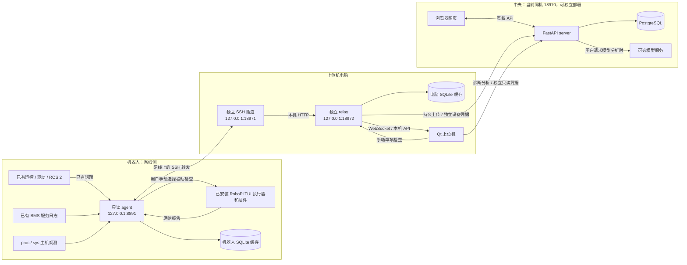
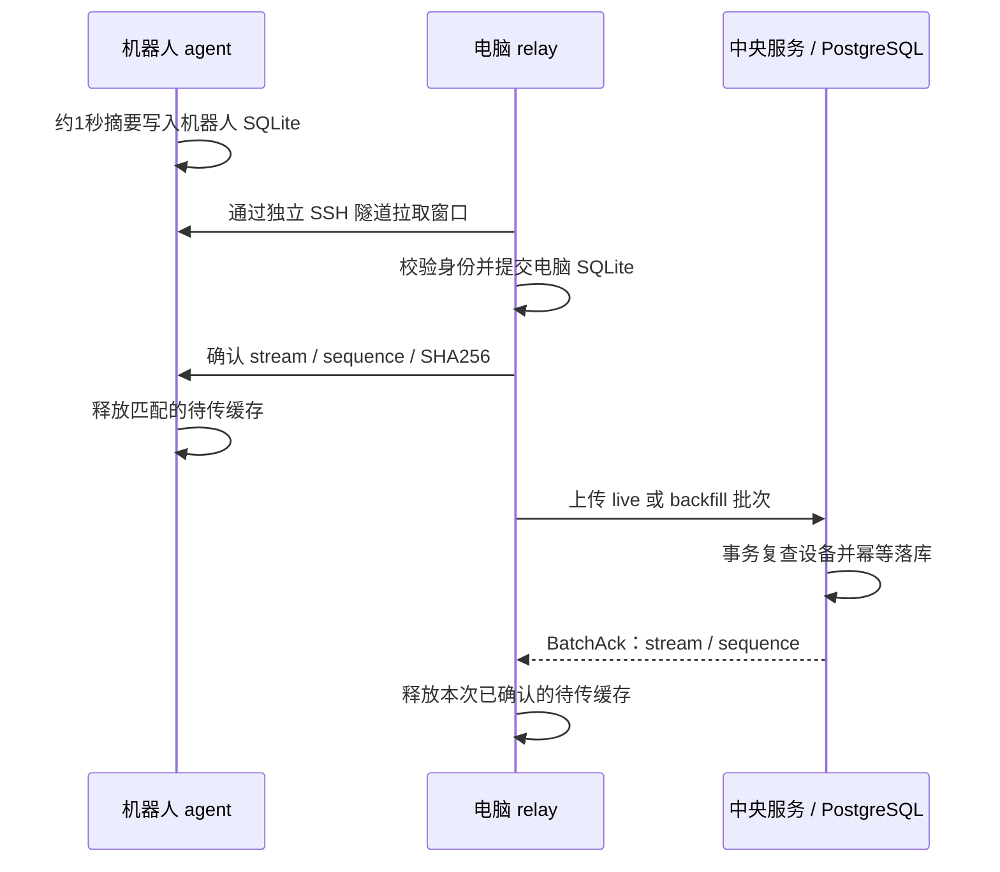

# RP1 整机监控技术架构

核对日期：2026-10-26。依据当前工程源码、部署模板及已记录的真机同步证据整理。本次只整理文档，没有连接或操作机器人。操作步骤见 [已安装 RoboPi TUI 后的部署与通信](DEPLOY_AFTER_ROBOPI_TUI.md)。

## 1. 系统由哪些部分组成

项目采用同一个 Python 包、按运行角色分开的结构。机器人、电脑和中央服务分别启动需要的角色，不需要在机器人上运行网页、Qt、PostgreSQL或大模型。

| 运行位置 | 程序 | 职责 |
| --- | --- | --- |
| 机器人 | 原有运控、驱动、ROS 2、BMS | 继续负责控制、硬件通信和原始消息发布 |
| 机器人 | 本项目 `agent` | 订阅已有消息，读取主机/BMS观测，汇总并缓存；按需调用已安装 TUI 的被动插件 |
| 上位机电脑 | 独立 SSH 隧道 | 通过网线，把机器人回环监听端口转发到电脑回环端口 |
| 上位机电脑 | 本项目 `relay` | 接收、校验、持久缓存，确认机器人已转交的数据，再上传中央 |
| 上位机电脑 | Qt 上位机 | 查看实时状态和曲线、手动硬件自检、诊断对话；退出窗口不停止独立 relay |
| 中央服务 | 本项目 `server` | 接收遥测、历史查询、告警、诊断分析、设备管理，并提供网页资源 |
| 中央服务 | PostgreSQL | 保存摘要证据、关键曲线投影、配置版本、报告和审计 |
| 浏览器 | 中文网页 | 按机器人和子页面展示中央数据；管理页面使用独立登录 |

当前中央服务与上位机可以部署在同一台电脑；两者仍是独立进程。将来中央迁到服务器时，电脑relay需调整中央地址、证书和相应凭据，Qt诊断助手另调整中央地址及只读凭据，浏览器使用新的网页地址；机器人仍不需要中央地址或外网。

本工程的监控数据与正式测试、审批、MTBF记录隔离；不会恢复旧测试数据接收链路，也不生成虚构计划/用例ID把监控记录写入正式测试。



图中双向箭头包含查询、确认和手动检查请求，不表示下发机器人动作。`agent` 不发布 `/joy`、`/cmd_vel`、`/action`，也不调用电机、标零或推理启停服务。

## 2. 当前真机部署对应关系

以下是已有部署记录中的配置，不表示本文发布时所有进程都在线。

| 项目 | 当前配置 |
| --- | --- |
| 机器人身份 | `RP1-ROBOPI2`，24关节 |
| SSH | `robo@192.168.137.250`；密码/私钥不写入文档 |
| 主控环境 | ARM64、Ubuntu 24.04、ROS 2 Jazzy、Python 3.12 |
| 板卡识别 | `RK3588S Orange Pi CM5 ROBOPI2` |
| 现有运控目录 | `/home/robo/roboparty_deploy` |
| 独立监控目录 | `/home/robo/.local/share/rp1-monitor/20261025-r1/` |
| TUI执行器 | `/opt/roboparty/lib/robopi-tui-source/706df3d/loader/plugin_executor.py` |
| 机器人监听 | `127.0.0.1:8891`，不直接向局域网暴露 |
| 电脑 SSH 转发 | `127.0.0.1:18971` → 机器人 `127.0.0.1:8891` |
| 电脑 relay | `http://127.0.0.1:18972`，Qt连接此地址 |
| 真机中央网页 | `http://127.0.0.1:18970` |
| 原模拟入口 | `http://127.0.0.1:18940`，不能用于判断当前真机状态 |
| 当前 PostgreSQL | 已有 Docker PostgreSQL 18 实例，宿主回环端口 `55434` |

当前采集端全部线程及其自有日志子进程允许在 CPU1、2、3、7运行，排除 CPU0；在 Python/ROS 初始化前由 `taskset` 限制，并以 `nice=10` 运行。这是允许调度集合，不是固定占某一个核，也不是 CPU 使用率上限。当前没有给本项目安装机器人开机自启。

## 3. 技术栈与代码分层

| 层 | 当前实现 | 主要文件/目录 |
| --- | --- | --- |
| 统一入口 | Python ≥3.10，`rp1-monitor` CLI，包版本0.4.0 | `pyproject.toml`、`cli.py`、`__main__.py` |
| 协议与档案 | Pydantic，明确身份、来源、单位、时间与质量 | `models.py`、`profiles.py`、`capabilities.py` |
| 机器人采集 | ROS 2 `rclpy` + 主机只读采样 | `agent.py`、`sources.py`、`health.py`、`host_cpu.py`、`process_monitor.py` |
| 汇总与可靠传输 | 秒级聚合、SQLite WAL/FULL、HTTP、SHA256 | `aggregation.py`、`spool.py`、`relay.py`、`transport_clock.py` |
| TUI适配 | 调用已安装 Python 执行器，单项白名单 | `robopi_tui.py`、`board_diagnostics.py`、`local_operations.py` |
| 本机服务与中央API | FastAPI + Uvicorn，HTTPX | `agent.py`、`relay.py`、`backend.py`、`operations_api.py` |
| 中央存储 | SQLAlchemy Core + psycopg，PostgreSQL；SQLite用于本地验证 | `storage.py`、`central_tables.py`、`central_data.py`、`report_store.py` |
| 原生上位机 | PySide6、pyqtgraph、NumPy | `desktop*.py`、`app_shell.py` |
| 网页 | 原生 HTML/CSS/JavaScript，按机器人子页面导航 | `web/`；`pages.js`、`components.js`、`operations.js` |
| 三维与展示 | Three.js 0.180.0、Swiper 12.0.3，本地打包资源与GLB | `frontend/`、`web/showcase-3d.js`、`web/vendor/`、`web/models/` |
| 共用状态投影 | 健康、热像、历史、配置与告警 | `health_view.py`、`motor_map.py`、`component_history.py`、`monitor_config*.py`、`monitor_alerts.py` |
| 诊断与模型 | 有限证据工具、Provider/Model/API注册和两类模型协议 | `monitor_service.py`、`assistant.py`、`model_providers.py` |
| 管理与SQL | 独立管理员身份、受控更正及审计、显式迁移 | `admin.py`、`deploy/postgres/` |
| 软件验证 | pytest、ruff、独立进程模拟、临时PostgreSQL | `tests/`、`scripts/`、`reviews/` |
| 运控集成材料 | 可供评估的诊断补丁、独立被动温度工具 | `integrations/robot-health/`；不是已自动部署的生产修改 |

表中 Python 文件均相对于 `src/rp1_monitor/`。Node 工具用于构建前端资源，机器人运行采集端不需要 Node、Qt或数据库驱动。各角色依赖由 `pyproject.toml` 的 `agent`、`server`、`desktop` extras 分开声明；relay 当前使用 `agent` 所需的基础服务依赖。

## 4. 数据从哪里来、采集多快

| 数据 | 真实入口 | 当前节奏与含义 |
| --- | --- | --- |
| 关节位置、速度、上报effort | 机器人内部 `/joint_states`，`sensor_msgs/JointState` | 随原发布者到达处理；本项目不改变发布频率 |
| 策略目标 | 机器人内部 `/action`，`sensor_msgs/JointState` | 只订阅；是策略目标，不是最终驱动目标 |
| IMU | 机器人内部 `/imu`，`sensor_msgs/Imu` | 取已提供的四元数和角速度；不展示未提供的线加速度 |
| 电机/MOS温度、故障 | 档案指定诊断话题，默认 `/rp1/diagnostics` | 需生产者提供有效字段和真实身份映射；当前真机未接通 |
| CPU总负载/每核负载、内存、开机时长 | `/proc/stat`、`/proc/meminfo`、`/proc/uptime` | 约1秒一次；每核负载为该核0–100% |
| 主控板热区 | `/sys/class/thermal/` | 约1秒一次；按内核实际热区枚举，不是电机温度 |
| 核心进程 | 档案名单匹配 `/proc/PID/comm` | 约2秒一次；存活、CPU、RSS、线程和观察到的实例变化 |
| 电池 | 跟随已有 `bms.service` 新日志 | 频率取决于原服务；主机采样1Hz不代表BMS实际1Hz |
| 预览 | agent/relay当前内存观测 | WebSocket约10Hz发送；relay正常接收循环间隔0.1秒，实际受请求耗时影响 |
| 中央持久遥测 | 机器人生成的 `TelemetryWindow` | 约1秒一个摘要窗口；不是保存全部高频消息 |
| relay状态/配置同步 | 上位机→中央 | 状态线程约5秒一轮，含配置同步；通信失败另有退避 |
| TUI检查 | Qt明确点击“运行所选单项” | 按需，单任务、至少10秒冷却；刷新/轮询不执行插件 |
| TUI报告转交 | 机器人→电脑→中央 | relay约5秒一轮，机器人分页最多两份 |

ROS订阅采用 `BEST_EFFORT`、`VOLATILE`、`KEEP_LAST depth=50`。低频入库并不代表低频接收：如果原话题高频发布，机器人上的订阅回调仍处理到达的消息，因此需要在实际推理工况测量CPU和控制周期影响。

## 5. 遥测、摘要与可靠缓存

每个窗口携带 `robot_id`、`source_kind`、`stream_id`、`sequence`、起止时间、指标与质量信息。适用指标保存最后值、最小值、最大值和样本数；跟踪RMS还要求有效同步配对证据及误差平方和，不能由两条低频曲线随意相减冒充。

窗口时间以主机接收时间为基准，并保留发布者时间和接收年龄；不把它宣称为传感器硬件采样时间。机器人时钟偏差另提供传输新鲜度证据，原始时间与哈希不改写。



- 机器人和电脑缓存都写本项目独立 SQLite，使用 WAL 与 `synchronous=FULL`，目录绑定机器人身份及来源。
- 机器人当前摘要预算128MiB、磁盘保留512MiB。超预算可能丢最旧待传摘要，并记录损失；磁盘不足时停止摘要写入并报告错误。这不删除原运控日志或rosbag。
- 电脑 relay 当前摘要预算256MiB、磁盘保留512MiB；满时保留已接收数据，拒收新摘要且不向机器人确认。
- 上述预算不是目录总大小、报告总量或进程内存上限。TUI报告、日志、SQLite额外空间及备份还会占磁盘。
- 中央幂等键为 `(robot_id, stream_id, sequence)`，同身份不同内容拒绝覆盖；补传只追加历史，不能把旧数据变成当前在线状态。
- TUI原始报告另存 `board-diagnostics.sqlite`，使用报告ID/SHA256确认，当前没有自动清理。
- 关闭Qt不影响独立后台；电脑关机、SSH断开、agent退出则分别中断对应链路。缓存有容量边界，不能承诺无限断网不丢数据。

## 6. RoboPi TUI 在架构中的位置

安装 TUI 只提供板端检查能力，不会自动把 ROS 遥测发送给本项目。持续遥测和按需自检是两个入口，共用本项目的通信及报告链路。

自检调用顺序：**Qt → 本机relay → SSH隧道 → agent → 现场TUI执行器 → 原插件 → 原始报告**。执行器使用 `--env csharp --no-save --run RPnnn`；`--no-save`只关闭上游自身归档，本项目仍保留报告。

当前14项：RP001、RP002、RP005、RP034，RP003、RP007、RP008，RP011、RP012、RP013、RP029，RP020、RP021、RP022。覆盖板温、镜像/包/序列号、网络/CAN接口、IMU命名规则、USB/串口枚举及BMS配置/日志/版本。前置项随原依赖执行，执行前校验原插件元数据。

单次调用45秒超时、输出总计256KiB，排除CPU0、nice至少10。RP022对部分BMS会扫描本次服务启动后的日志，因此额外用现有`prlimit`限制执行器及后代**每进程192MiB虚拟地址空间**；不是整棵进程树RSS上限，也不限制日志IO，缺工具时拒绝运行。

未开放会发送IMU寄存器查询的RP009/RP010，以及包含主动调频写操作的RP040。不会因“检测”而重置USB、重启BMS、升级固件、修改电机参数或启动推理。RP001提供主控板温度，不提供关节电机温度。

## 7. 上位机与网页

Qt先读取`/api/v1/doctor`核对角色、机器人和来源，再连接预览。主页为整机健康，另有部件、趋势、告警、设置、诊断助手及独立第7页“硬件自检”。硬件页保留14项各自最近结果；断线可读历史，不能发起新检查。

网页由中央FastAPI提供，不能使用`file://`直接打开。路径包括：

```text
/robots
/robots/{id}/overview       整机状态：结构 / 关节热像切换
/robots/{id}/battery        SOC、电压、电流、温度和区间极值
/robots/{id}/joints         关节反馈、策略目标、上报力矩与有效配对RMS
/robots/{id}/host           主机温度、CPU逐核、内存和开机时长
/robots/{id}/temperature    关节测点温度与伪彩
/robots/{id}/history        历史曲线
/robots/{id}/processes      核心进程
/robots/{id}/storage        数据告警 / 存储观测
/robots/{id}/diagnostics    诊断对话与最近TUI报告
/admin                     独立管理工作台
```

中央API已经返回TUI各项历史，当前网页诊断区仍渲染**最近一份报告**，尚无与Qt相同的独立14项自检页面；网页不能运行机器人插件。

24/28自由度、关节部位映射、温度策略由版本化监控配置提供。三维模型是结构展示，不是实时姿态；“热像”是测点驱动的SVG伪彩示意，不是红外相机成像。未定位、未提供或过期的温度保持未知。

## 8. 中央数据库、归档与权限

当前设计有14个表，核心11表加管理2表、配置版本1表：

| 分类 | 表 |
| --- | --- |
| 登记、当前状态 | `monitor_robots`、`monitor_latest` |
| 原始摘要、关键投影 | `monitor_windows`、`monitor_key_windows` |
| 策略、容量 | `monitor_policy_versions`、`monitor_daily_usage` |
| relay状态 | `monitor_relay_status` |
| 告警 | `monitor_alert_heads`、`monitor_alert_events` |
| 诊断、归档 | `monitor_diagnostic_records`、`monitor_archive_manifests` |
| 人工更正、审计 | `monitor_metric_corrections`、`monitor_admin_audit` |
| 机型与温度配置版本 | `monitor_robot_config_versions` |

“原始数据”在这里指本项目接收到的秒级摘要证据，不是全部原始ROS帧。原始摘要与关键投影目前同时保存，关键层不会自动替代或删除原始层。规范证据使用JSON，部分查询投影使用JSONB。

**当前没有PostgreSQL表分区、中央自动按月清理或清理定时任务。** 普通窗口表使用机器人/时间B-tree、时间BRIN及幂等约束。30天是候选保留参数；到期接口仅预览，明确`dry_run=true`、`deletion_enabled=false`。显式`archive`按UTC小时复制为JSONL.gz，验证哈希、CRC、内容和范围后追加清单，仍不删除源记录。

正式服务使用`--no-initialize`，SQL迁移由部署维护者显式审阅执行。现有环境不应通过重新建库或启动自动建表来更新界面。

| 身份 | 能做什么 | 不能做什么 |
| --- | --- | --- |
| 设备上传凭据 | relay上传绑定机器人的遥测、状态和报告，读取自己的配置 | 不能管理其他机器人或获得页面管理员权限；不下发到机器人 |
| 页面只读凭据 | 查询、生成中央诊断记录、请求只读分析 | 不能更正登记或执行机器人TUI插件 |
| 管理员 | 独立登录，登记机器人、改监控配置、追加更正/排除/撤销和审计 | 不直接改原始遥测、原始哈希或机器人运控 |
| 数据库迁移所有者 | 显式SQL部署维护 | 不作为API运行身份 |

数据库另有app、reader、archiver、admin等NOLOGIN组角色及受控函数角色，业务运行身份无DELETE/TRUNCATE/DDL。人工更正保留原始证据，管理查询提供更正投影，不能宣称全部普通曲线都已替换为更正值。当前为单组织服务，通过API身份和最小数据库权限隔离，没有按组织/设备多租户RLS。

## 9. 诊断Agent怎样工作

Qt和网页共用中央分析服务。Qt的实时预览/硬件自检访问relay，诊断提问/模型设置则直接访问单独配置的中央地址及只读凭据。分析器读取选定机器人的当前观测、能力、告警和有限历史，只拥有固定证据查询工具，没有SSH、shell、任意SQL、TUI执行或机器人控制工具。

模型接入采用Provider/Model/API注册分层，支持OpenAI Responses及兼容Chat Completions，提供DeepSeek、千问和已登记网关。用户显式启用后才发送问题、有限对话和所选证据；机器人不调用模型。不启用模型时可执行中央本地规则分析，仍需中央链路可用。

模型交互有轮数、工具调用数、证据体积和并发限制；客户端不能让模型随意改变机器人范围或网关地址。界面输入的Key只保留在当前应用/页面内存，不保存到聊天历史、遥测或报告；退出应用或离开页面后释放，关闭设置弹窗本身不会立即清除。服务端Key由中央私有环境提供。远程中央连接使用HTTPS，机器人侧不保存模型Key。配置细节见 [多模型连接](MODEL_CONNECTIONS.md)。

## 10. 已验证与尚待完成

| 项目 | 当前证据边界 |
| --- | --- |
| 主机/BMS→机器人→relay→中央→界面 | 已有真实读取记录；不等于长期稳定性或健康验收 |
| 24关节与IMU | 修复真实IMU数组适配后，短时读取位置、速度、上报effort、策略目标及IMU通过；当前值取决于实际发布者 |
| TUI真机同步 | 已更新现有独立采集包；RP034、RP029两项真实报告经relay入库并显示，其余12项本次未逐一实测 |
| 电机/MOS温度、故障与真实热像 | 未接通有效诊断来源及确认映射，保持未知；不会自动采用板温代替 |
| 跟踪RMS | 要求有效配对，真实同步配对尚未验收 |
| 性能 | 有短时资源样本；推理工况长期CPU峰值、控制周期、调度延迟、总线稳定性待验证 |
| 软件回归 | 已记录SQLite/临时PG首轮585项通过、收尾相关68项通过；覆盖有重叠，不相加，不等于真机验收 |
| 开机自启、自动归档/清理、PG分区 | 未实施 |

机器人侧最新TUI同步只新增2个模块、替换3个模块，并给本项目启动器追加1个参数；没有修改原TUI、运控、策略、驱动或BMS代码。完整逐文件说明和备份路径见 [真机同步记录](ROBOPI_TUI_SYNC.md) 与 [机器人改动清单](ROBOT_CHANGES.md)。后续部署、升级和停止均应延续这一可核查范围。
